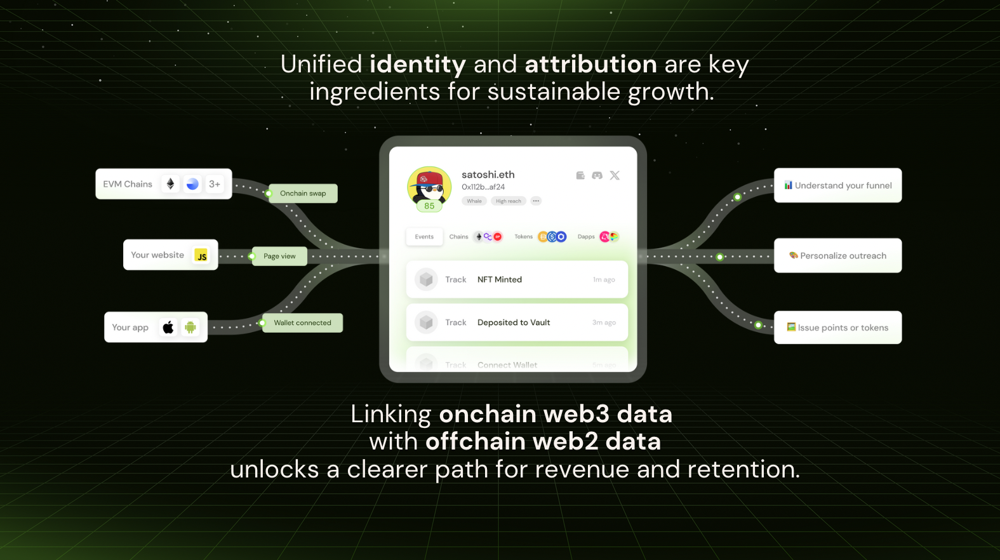
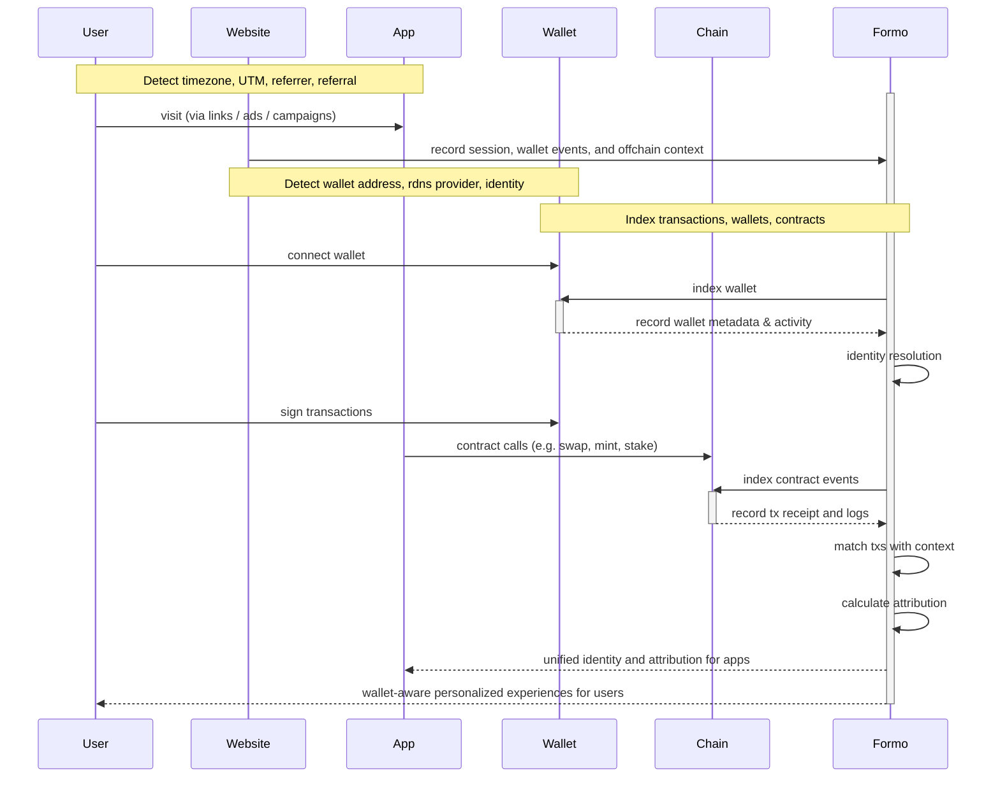

### Overview

User acquisition is one of the biggest problems in crypto. For an app to succeed, it must have **sustainable unit economics** when it comes to user acquisition. The lifetime revenue of a user (LTV) should be greater than the cost to acquire them (CAC) at a healthy multiple.

<Frame>
  
</Frame>

Without accurate attribution, you are lost in the dark forest. Attribution helps answer:

- Where did users come from?
- What meaningful activity did users perform on my app?
- How well are users monetizing? How much revenue did I make? (ARPU, LTV)
- How long are users sticking around? (Retention, Churn)
- Is my ROI for an acquisition channel positive? (LTV \> CAC)

### Example

Attribution in web3 is _complex_.

Consider the following example user journey for a DEX called FooSwap with many touchpoints:

- A user sees a tweet thread about an app on X (_"referrer"_) clicks on a referral link
- The user visits the app's website (fooswap.com)
- The user visits the app (app.fooswap.com)
- The user connects their wallet on the app
- The user signs a token approval message
- The user starts a swap transaction but the wallet has insufficient gas
- The user abandons their transaction (_"dropoff"_)
- The user revisits the app from another channel on Farcaster (_"referrer"_)
- The user completes a swap transaction (_"conversion"_) emitting an onchain event

As you've seen in the above example, not everything you care about is onchain. In this example, two touchpoints contribute to the successful conversion: X and Farcaster. Using an [attribution model](/data/attribution#attribution-models), we can determine which touchpoint to credit for the conversion:

- Using the first-touch model, the complete conversion is attributed to X and the referral
- Using the last-touch model, the complete conversion is attributed to Farcaster

### How attribution works in Formo

To understand the full user journey, **we must navigate two different worlds: offchain and onchain.** It's imperative to trace the event sequence from initial engagement offchain to conversion onchain.

Here's a high-level overview of how it works:

Formo solves two core functions: attribution and identity.

- **Attribution** refers to [event-based analytics](/data/events/overview) about where, how, and when users interact with links, sites, and apps (touchpoint trackers, UTM & referral parameters, events, ingestion).
- **Identity** refers to the resolution of user activity into a single [unified profile](/features/wallet-intelligence/wallet-profiles) (sessions, demographics, wallets, onchain data).

Spend less time building analytics and leave the complex data engineering to us.

### Ad click IDs

Paid acquisition is attributed with ad-platform click IDs (`gclid`, `fbclid`, `twclid`, and friends): the identifier each ad network appends to your landing page URL. Formo captures them automatically, classifies the acquiring network (Google Ads, Meta Ads, X Ads, TikTok Ads, LinkedIn Ads, Reddit Ads, Microsoft Ads), and uses them for channel classification even when the referrer is missing (common with in-app browsers). See [Ad attribution](/features/attribution/ads) for the supported platforms and every dashboard surface they power.

### Attribution models

Formo helps you understand the impact of touchpoints in each user journey using single-touch attribution, crediting either the first or the last touchpoint.

| Model | Description |
| :-- | :-- |
| First Touch | Gives 100% credit to the first touchpoint |
| Last Touch | Gives 100% credit to the last touchpoint |

Which touchpoints count depends on the report:

- **Wallet profiles:** first touch and last touch use the wallet's full history. Each field (each UTM parameter, the referrer, the referral code, and the ad click) is resolved on its own, so a wallet's first `utm_source` and its first referrer can come from different events.
- **Funnels:** breakdowns use each user's first or last real value (not empty and not Direct) inside the selected date range.
- **Contract events:** an onchain event inherits the attribution (UTM parameters, referrer, and country) of the same wallet's SDK session from the last hour. If the wallet has no SDK session in that hour, the event is attributed to Direct.
- **Revenue and volume breakdowns:** use the channel of each event. Traffic reports use the channel of the session's entry page view.

> Looking for more attribution models? [Let us know](mailto:support@formo.so).

### Glossary

| Term | Definition |
| :-- | :-- |
| User journey | Consists of touchpoints and the conversion event. It is possible for a conversion event to have no corresponding touchpoints (eg. utm parameters). In this case we consider it a 'direct' conversion |
| Conversion | The primary event you're interested in attributing. Typically a volume or revenue generating conversion event such as "Mint" or "Swap" or "Stake". |
| Touchpoint | Actions (events) a user's taken or exposed to along the journey before doing the conversion event. \[Eg. does event A → B → C → D (conversion event); A, B, C are all considered touchpoints\] |
