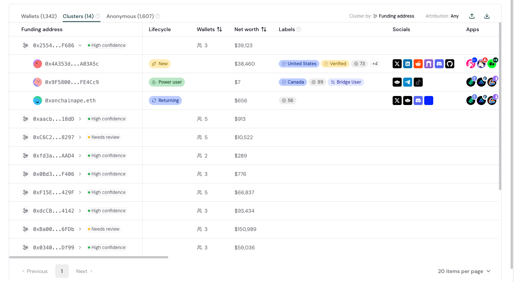
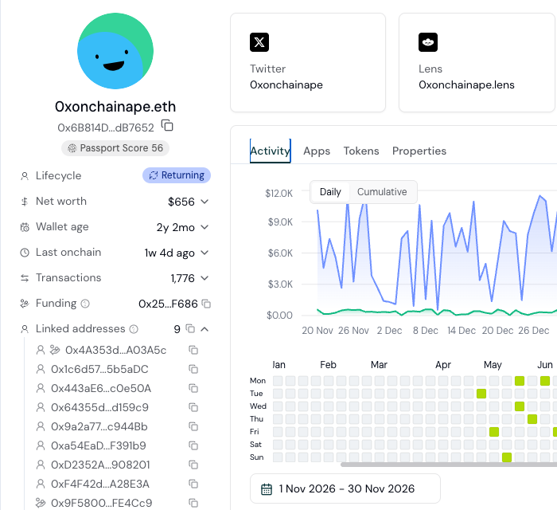

<Frame caption="Clusters on the Users page, clustered by funding address.">
	
</Frame>

## Overview

**Identity resolution** answers one question: which of your wallets belong to the same person or team?

A wallet address is not a user. One person often has several wallets: a main wallet, a hardware wallet, a trading wallet, a wallet for each chain. Some people create many wallets on purpose, to collect a referral bonus, an airdrop, or a competition reward more than one time.

When you treat each wallet as a separate user, three things go wrong:

- **You overstate your audience.** 1,000 active wallets can be 600 people. Growth, retention, and conversion numbers by wallet look better or worse than the real ones.
- **You misjudge your best users.** The value of one user is spread across several wallets, so a high-value user looks like several small ones.
- **You pay for the same user more than one time.** Incentive programs that reward each wallet reward the people who create the most wallets.

Formo groups linked wallets into **clusters**, shows the reason for every link, and lets you review and export each cluster. You decide what to do with it: merge the wallets in your own analysis, focus on a high-value user, or exclude a cluster from a program.

## Two ways to link wallets

Formo links wallets with two independent signals. One comes from your app and one comes from the chain. Formo keeps them separate, because they prove different things.

| | Identity | Funding address |
|:--|:--|:--|
| **The wallets share** | A device or a user ID | The address that first funded them onchain |
| **Where the signal comes from** | Your app: the Formo SDK and your `identify` calls | The chain: the first gas transfer to each wallet |
| **Kind of evidence** | A direct match on data from your app | An inference from onchain data, with a confidence level |
| **What it finds** | One user who connects several wallets | Wallets that one operator prepared, also when each wallet uses a separate device |
| **What it misses** | Wallets that are never used on the same device or account | Wallets that were funded from different sources |

The two signals cover each other. Identity is a direct match on data from your app, so it needs no inference. It still is not proof of one owner, because two people can share one device. And an operator who uses a new browser profile for each wallet is invisible to it. The funding address sees that operator, but it needs care, because exchanges and bridges also fund many unrelated wallets. A link that both signals confirm is the strongest one.

## Identity clusters

Identity clusters group wallets that belong to the same user. Two shared identifiers link wallets:

- **The anonymous ID.** The same browser or device, across sessions and days.
- **The user ID** that you set with [`identify`](/data/events/identify).

This is a direct match on data from your app. Formo does not use IP addresses or device fingerprinting.

Identity clusters are transitive. If wallet A shares a device with wallet B, and wallet B shares a user ID with wallet C, then A, B, and C are one cluster. A cluster can include wallets that were never seen on the same device as each other.

Guards stop shared devices and bots from merging unrelated wallets into one cluster.

<Tip>
Call [`identify`](/data/events/identify) with your own user ID when a user signs in. It links the wallets of one account across devices, which the anonymous ID cannot do.
</Tip>

## Funding clusters

Funding clusters group the wallets of your project that were first funded onchain by the same address.

The **funding address** of a wallet is the account that sent the wallet its first native gas on a chain. When several wallets of your project share a funding address, they form one funding cluster. The cluster is named by that address.

Funding clusters find what identity clusters cannot: an operator who prepares many wallets from one source and then uses each wallet from a different device.

### How Formo finds the funding address

- Formo reads the first incoming native transfer of the wallet on each supported EVM chain and on Solana.
- When a contract sent the transfer, for example a disperse contract, Formo uses the account that signed the transaction.
- When the wallet signed its own funding transaction, for example a claim or its own bridge deposit, the wallet has no funding address on that chain.
- A wallet can have a different funding address on each chain. It can be in more than one funding cluster.

### Services do not form clusters

Most first funding does not come from a person. It comes from infrastructure: exchanges, bridges, relayers, and gas services. Such an address funds many unrelated wallets, so Formo does not build a cluster from it.

Formo recognises a service in several ways:

- **Public address labels** for exchanges, bridges, and gas services.
- **Activity.** An account that sends far more transactions than a person can is a service, also when it has no public label yet.
- **Relayers.** An account that deploys a separate contract for each user links no wallets.
- **Reach.** An address that funded a very large number of wallets across all projects is a service.

When the funding address of a wallet is a service, the wallet profile shows what it is: the name of a known exchange or bridge, or its type (**Exchange**, **Bridge**, **Gas service**, **Service**).

### Confidence level

Each funding cluster shows a confidence level.

| Level | When | What it means |
|:--|:--|:--|
| **High confidence** | The funding address is itself a wallet of your project, or two or more wallets in the cluster also share an identity cluster | The wallets are probably controlled by one owner |
| **Needs review** | Neither is true | Check the wallets before you act. The funding address can be a service that has no label yet |

Hover the level to see the reasons, for example how many wallets share an identity cluster and within how many days the wallets were funded.

<Note>
**Needs review** does not mean that the cluster is wrong. A farming operation that funds its wallets from an outside address and uses a separate device for each wallet shows as **Needs review**. A short funding window, for example ten wallets funded within minutes, is a strong sign of one operator.
</Note>

## Where you see clusters

### Clusters tab

On the **Users** page, open the **Clusters** tab. Use the **Cluster by** control to switch between **Identity** and **Funding address**. Expand a cluster to see its wallets. Filters, segments, and search apply to both views.

### Wallets tab

The **Links** column shows how many other wallets are linked to each wallet. It counts each linked wallet one time, whatever the reason. Hover the number to see the linked wallets and an icon for the reason of each link.

### Wallet profile

<Frame caption="A wallet profile with its funding address and its linked addresses.">
	
</Frame>

- **Funding** shows the funding address of the wallet, or the service that funded it.
- **Linked addresses** lists every wallet linked to this one, with an icon for each reason.

| Reason | Meaning |
|:--|:--|
| **Same device** | The two wallets were seen on the same browser or device |
| **Same user ID** | The two wallets have the same user ID from `identify` |
| **Same identity cluster** | The two wallets are in one identity cluster, linked through other wallets |
| **Same funding address** | The two wallets were first funded by the same address |

A wallet can have more than one reason. A wallet that shares both an identity cluster and a funding address with this one shows both icons, which is the strongest link.

### CSV export

Exports from the Users page include the links:

| Column | Tab | Meaning |
|:--|:--|:--|
| `linked_addresses_count` | Wallets | The number of wallets seen on the same device. It does not count wallets linked only by user ID, by the identity cluster, or by funding address |
| `funding_addresses_count` | Wallets | The number of wallets with the same funding address |
| **Linked addresses** | Wallets, Clusters | The linked wallets, for every reason |
| **Linked by** | Wallets, Clusters | The reasons for the links |
| **Funding address** | Wallets, Clusters | The funding address of the wallet or of the cluster |
| **Confidence** | Clusters, by funding address | **High** or **Needs review** |

The two count columns are separate, and a wallet that is linked both ways is in both. So they do not add up to the number in the **Links** column, which counts each linked wallet one time for every reason. The **Linked addresses** column holds that full list.

## How to review a funding cluster

1. On the **Clusters** tab, set **Cluster by** to **Funding address**.
2. Sort by **Wallets** to see the largest clusters first.
3. Read the confidence level and its reasons.
4. Expand the cluster. Compare the wallets: their first seen dates, countries, devices, and activity in your app.
5. Open a wallet profile to see every link of that wallet and the reason for each one.
6. Export the cluster as a CSV file to review it with your team or to exclude the wallets from a program.

## Limits

Read funding clusters as a signal, not as proof.

- **The link is inferred.** One person can send gas to a friend. Wallets in one funding cluster can belong to different people.
- **Labels arrive late.** A new service wallet can form a cluster for a short time before Formo recognises it. The confidence level marks such a cluster as **Needs review**.
- **Coverage fills in over time.** Formo looks up the funding address when a wallet is active on your app. A wallet that was not active recently can have no funding address yet.
- **Contract funding is not visible on every chain.** On some chains Formo sees direct transfers only. A wallet that was first funded through a contract on such a chain can show a later funding address, or none.
- **No transitive merge.** If address A funded wallet B, and wallet B funded wallet C, Formo shows two clusters that share wallet B, not one chain.

## Privacy and access

- Clusters never cross projects. Formo builds them from the wallets of one project only.
- Funding links are not used in your user counts, monthly active users, or billing.
- Clusters, linked addresses, and funding data are sensitive profile data. Owners and Admins can hide them from Viewers. See [Role Based Access Control](/security/roles).

## FAQ

<AccordionGroup>
  <Accordion title="Why does a wallet show linked addresses but no identity cluster?">
    The wallet is linked by funding address only. Open the **Clusters** tab and set **Cluster by** to **Funding address** to see its cluster.
  </Accordion>
  <Accordion title="Why does the funding address of a wallet show an exchange?">
    The wallet received its first gas from an exchange withdrawal. That tells you where the wallet got its funds. It does not link the wallet to other wallets, because an exchange funds many unrelated people.
  </Accordion>
  <Accordion title="Can a wallet be in several clusters?">
    A wallet is in one identity cluster at most. It can be in several funding clusters when different addresses funded it on different chains.
  </Accordion>
  <Accordion title="Do funding clusters change my monthly active users?">
    No. User counts, monthly active users, and billing do not use funding links.
  </Accordion>
  <Accordion title="Which chains are covered?">
    Funding addresses are found on the major EVM chains and on Solana. Public labels for services cover the major EVM chains. On Solana, Formo recognises services by their activity.
  </Accordion>
</AccordionGroup>
