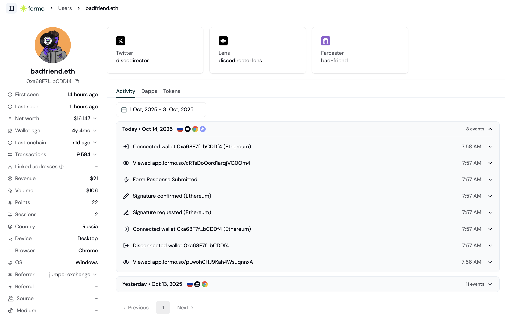

<Frame caption="View a user's DeFi positions and token balances across multiple chains.">
	
</Frame>

Formo's **Wallet Profiles** unifies offchain and onchain data into 360° profiles of your users:
- Wallet address, ENS profile, net worth, and transaction frequency
- Real-time feed of what each user is doing on your crypto app, with full attribution through referrers and UTM sources
- DeFi positions and token balances of the user across multiple chains
- Linked wallet addresses
- Social profiles
- Onchain attestations
- [Wallet labels](/features/wallet-intelligence/wallet-labels)
- Volume, revenue, and points on your app

## User Lifecycle

Each user's lifecycle stage is computed relative to a **reference date** (the end of the queried date range, which defaults to today). The default thresholds are shown below; projects can override them in **Settings → Lifecycle**.

| Lifecycle | Definition |
|:----------|:------------|
| **New** | First seen within the last 30 days and still active. |
| **Returning** | Established active users who don't fit another stage: active recently but not New, Power, At Risk, or Resurrected. |
| **Power user** | First seen more than 30 days ago, still active, and active on at least 5 distinct days in the last 30 days. |
| **At Risk** | Previously active wallet whose activity has slowed but that hasn't churned yet: last seen at least 14 days ago, fewer than 5 active days in the last 30 days, and no 30+ day gap, with at least 1 active day in the prior 30 to 60 days. |
| **Churned** | Last seen at least 30 days ago. |
| **Resurrected** | First seen more than 30 days ago, active within the last 30 days, and has at least one gap of 30+ days between active days at any point in its history. |
| **Imported** | Wallet that has only imported data and no tracked activity. Shown on the Users list, but not counted in the lifecycle chart. |

Stages are mutually exclusive and evaluated in precedence order: Churned, New, Power user, Resurrected, At Risk, Returning. Imported applies only to wallets with no tracked activity and sits outside this order. **At Risk** carves out fading users that would otherwise sit in Returning, surfacing established wallets to re-engage before they churn.

An active day is a UTC calendar day on which the wallet has any event that carries its address. Imported data does not count as activity.

Filter users by lifecycle to create [segments](/features/wallet-intelligence/segments) and audiences. For example, "Show me whales who use app X who are power users" or "Show me high net worth wallets who are at risk."

## User Wallet Metadata

Each wallet profile includes key metadata aggregated across all chains:

| Field | Description |
|:------|:------------|
| **Net Worth** | Total USD value of verified token holdings and, where available, DeFi positions (net of debt), with a per-chain breakdown showing percentage allocation. Solana wallets include token balances only. |
| **Wallet Age** | Time since the wallet's first onchain transaction. |
| **Last Onchain** | When the wallet last had onchain activity. |
| **Total Transactions** | Lifetime transaction count across all chains, with a per-chain breakdown. |
| **Funding** | The address that first sent native gas to this wallet. A known exchange, bridge, or gas service is shown by name. See [Funding clusters](#funding-clusters). |
| **Linked Addresses** | Other wallets linked to this one: wallets seen on the same device or with the same user ID, and wallets first funded by the same address. An icon on each address shows the reason for the link. See the **Clusters** tab on the Users page for the full multi-wallet group. |
| **Sessions** | Total number of sessions on your app. |
| **First Seen / Last Seen** | When the user first and last interacted with your app. |
| **Country, Device, Browser, OS** | Geographic and device information from the user's sessions. |

**How wallets are linked.** Formo links wallets in two separate ways, and the **Clusters** tab on the Users page has a **Cluster by** control to switch between them.

### Identity clusters

Identity clusters group wallets that belong to the same user. Wallets are linked through two shared identifiers: the anonymous ID cookie (the same browser or device, across sessions and days) and the user ID you set with [`identify`](/data/events/identify). This is a direct match on data from your app. It does not use IP addresses or device fingerprinting.

Identity clusters group wallets transitively through shared devices and shared user IDs, so a cluster can include wallets that were never seen on the same device as each other. Guards stop shared devices and bots from merging unrelated wallets.

### Funding clusters

Funding clusters group wallets that were first funded onchain by the same address. The funding address of a wallet is the sender of the first native gas transfer that the wallet received on a chain. When several wallets of your project share a funding address, they form one funding cluster, and the cluster is named by that address.

Funding clusters help you find wallets that one person or one team controls, for example in referral, bonus, and competition programs.

Read funding clusters as a signal, not as proof:

- The link is inferred from onchain data. Wallets in one funding cluster may belong to different people, for example when one person sends gas to a friend.
- Exchanges, bridges, and gas services fund many unrelated wallets, so they never form a cluster. When the funding address of a wallet is a known service, the wallet profile shows the name or the type of the service.
- A wallet can be in more than one funding cluster when it was funded by different addresses on different chains.
- Formo looks up the funding address when a wallet is active on your app, on supported EVM chains and Solana. A wallet that was not active recently may have no funding address yet.
- Funding links never change your user counts, monthly active users, or billing. Those use identity only.

Funding data is visible to team members who have access to sensitive user data. Clusters of both types never cross projects.

## User Socials

View social accounts linked to a wallet address. Formo resolves onchain identities and social profiles from multiple sources including ENS, Web3Bio, and more.

Supported platforms:

| Platform | Description |
|:---------|:------------|
| **Twitter / X** | X (formerly Twitter) handle |
| **Farcaster** | Farcaster profile |
| **Lens** | Lens Protocol handle |
| **GitHub** | GitHub username |
| **LinkedIn** | LinkedIn profile |
| **Discord** | Discord username |
| **Telegram** | Telegram handle |
| **Reddit** | Reddit username |
| **Instagram** | Instagram handle |
| **Facebook** | Facebook profile |
| **TikTok** | TikTok handle |
| **YouTube** | YouTube channel |
| **Email** | Email address |
| **Basenames** | Base chain name |
| **Linea** | Linea Name Service (.linea) domain |
| **Website** | Personal or project website |

Social cards are displayed in a grid on the wallet profile page. Click any card to copy the handle or open the external profile.

## User Apps

The **Apps** tab shows a user's DeFi positions on supported EVM chains. Solana wallets show token balances only, with no protocol positions. See which protocols a user is active in and the USD value of their positions.

| Column | Description |
|:-------|:------------|
| **App** | Protocol name and logo (e.g., Aave, Uniswap, Lido) |
| **Chain** | The blockchain network |
| **Value** | USD value of the position |
| **Portfolio %** | Percentage of the user's total DeFi portfolio |

Filter by individual chain or view all positions at once. Apps are sorted by USD value from highest to lowest.

## User Tokens

The **Tokens** tab shows token balances held by the wallet across all major chains.

| Column | Description |
|:-------|:------------|
| **Token** | Token name, symbol, and logo |
| **Chain** | The blockchain network |
| **App** | Protocol where the token is held (if applicable) |
| **Amount** | Token quantity |
| **Value** | USD value of the balance |
| **Portfolio %** | Percentage of the user's total token holdings |

Filter by individual chain or view all tokens at once. Tokens are sorted by USD value from highest to lowest.

## User Attribution

Track how each user discovered and arrived at your app. Formo captures both first-touch and last-touch attribution for every user.

| Field | Description |
|:------|:------------|
| **Referrer** | The website or page that sent the user to your app. Both first and last referrer are tracked. |
| **Referral** | The referral parameter (`ref`) used when the user arrived. |
| **UTM Source** | The traffic source (e.g., `twitter`, `google`). |
| **UTM Medium** | The marketing medium (e.g., `cpc`, `email`, `social`). |
| **UTM Campaign** | The campaign name. |
| **UTM Term** | The paid search keyword. |
| **UTM Content** | Differentiates ad variations or links within the same campaign. |

All UTM parameters track both first-touch and last-touch values, so you can see how a user originally found your app and what brought them back most recently.

## User Activity

View users' active days at a glance with the activity chart. Activity charts are available on wallet profile and anonymous profile pages, showing engagement patterns over time.

> Let us know what you'd like to know about your onchain users. Message us via [email](mailto:yos@formo.so).

---

## How to research individual users

Wallet profiles let you drill into specific users to understand their behavior, investigate issues, or identify opportunities. This guide shows you how.

### Step 1: Find a user

There are several ways to access wallet profiles:

**From the Users list:**
1. Go to **Users** in the left navigation
2. Click any wallet address to open their profile

**From the Activity feed:**
1. Go to **Activity**
2. Click on any event
3. Click the wallet address to open their profile

**Direct search:**
1. Use the search bar at the top of the dashboard
2. Enter a wallet address or ENS name
3. Click to open the profile

### Step 2: Understand the profile overview

The profile header shows key information at a glance:

| Field | What it shows |
|-------|---------------|
| **Address** | Wallet address with copy button |
| **ENS** | ENS name, if resolved (falls back to a shortened address) |
| **Net Worth** | Total value across all chains |
| **Lifecycle** | New, Returning, Power user, At Risk, Churned, or Resurrected |
| **First Seen** | When they first visited your app |
| **Last Seen** | Most recent activity |

Any auto-generated labels (verifications, campaign participation, agent detection) appear as badges next to the wallet's name. See the [full list of labels](/features/wallet-intelligence/wallet-labels) for details.

### Step 3: Review the activity timeline

The **Activity** tab shows everything this user has done on your app:

- Page views with URLs
- Wallet connects/disconnects
- Transactions with status
- Custom events you've tracked

Each event shows:
- Timestamp
- Event type and details
- Referrer/UTM attribution (how they arrived)
- Device and location

<Tip>Use the activity timeline to debug user issues. If a user reports a problem, find their profile and review their recent activity to understand what happened.</Tip>

### Step 4: Explore onchain data

The **Apps** and **Tokens** tabs show the user's onchain footprint:

**Apps tab (DeFi positions):**
- Active positions in protocols (Aave, Uniswap, etc.) across supported chains
- USD value and portfolio percentage for each position
- Useful for understanding which crypto apps the wallet interacts with

**Tokens tab (token balances):**
- All tokens held across supported chains
- Token amounts, USD values, and portfolio percentages

### Step 5: Check properties and custom labels

The **Properties** tab shows:

- Editable user properties: display name, user ID, email, socials, ENS/Basenames/Linea, website, location
- Custom user labels you or your team have added, separate from the auto-generated labels shown in Step 2

Use this tab to enrich a profile with known information or tag it for later segmentation.

### Common use cases

**Customer support:**
1. User reports an issue
2. Find their profile by wallet address
3. Review activity timeline to see what happened
4. Check transaction status and error details

**Sales/BD outreach:**
1. Identify high-value users (filter by net worth)
2. Review their onchain activity
3. Find social profiles for outreach
4. Understand their other app usage

**Product research:**
1. Find power users in your segments
2. Study their activity patterns
3. Identify features they use most
4. Discover unmet needs from their other app usage

**Fraud investigation:**
1. Flag suspicious activity in alerts
2. Open the user's profile
3. Check wallet age, transaction patterns
4. Review linked wallets and labels
